<div align="center">


# Aurora UI

**A complete redesign of the OctoPrint web interface.**<br>
Light and dark themes, your own accent color, a cleaner layout, and nothing to relearn: every OctoPrint feature and plugin stays where it was.

[](LICENSE)
[](https://octoprint.org)
[](pyproject.toml)
[](#languages)

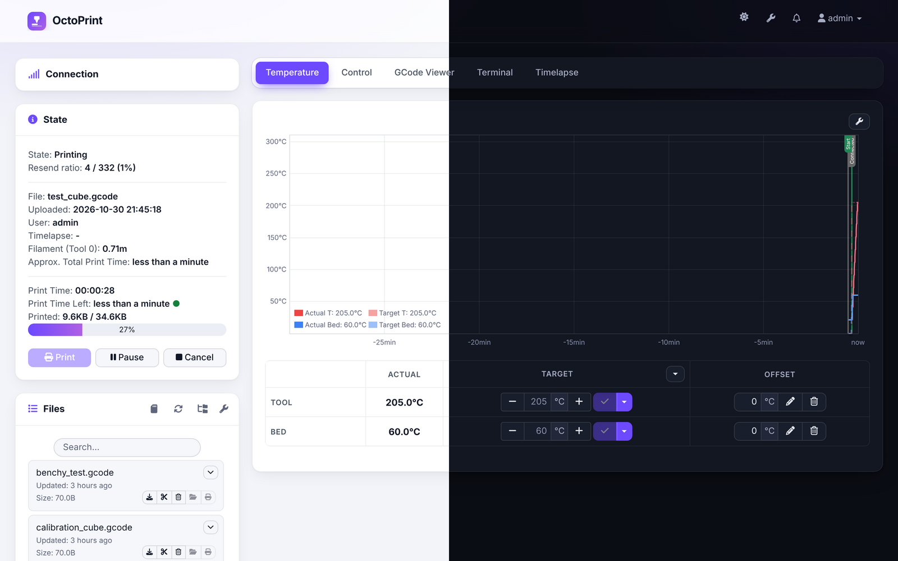

</div>

## Features

- **Redesigned from top to bottom.** Card panels, pill tabs, modern buttons and forms, tables, dialogs, menus, notifications, terminal and file list.
- **Light, dark or automatic theme.** Automatic follows your operating system. A moon/sun button in the navbar lets each browser pick its own.
- **Your accent color.** Nine presets or any color you like. Text on colored buttons switches between white and black so it always stays readable.
- **Themed graphs.** The temperature graph and the GCode viewer are drawn in the theme colors, so the dark theme stays dark everywhere.
- **Layout options.** Sidebar on the left or right, comfortable or compact density, full width on large screens, adjustable corner radius.
- **A styled login page**, using the same theme and accent color.
- **Tells your printers apart.** The instance color from *Settings › Appearance* shows as a thin stripe at the top of the screen, or becomes the accent color.
- **Live preview.** Changes in the settings apply as you make them, and are reverted if you close without saving.
- **Accessible.** Text contrast meets WCAG AA (4.5:1) in both themes, on every OctoPrint page.
- **Off in one click.** Untick *Enable* and the stock interface is back instantly.

### Built for printing

- **Print status card.** While printing, a card above the tabs shows the model thumbnail (from Slicer Thumbnails or Cura Thumbnails), a progress ring, time left, the expected finish time, the current layer (with DisplayLayerProgress) and temperatures, with Pause, Resume and Cancel at hand. On a phone it comes first on the page.
- **Progress in the browser tab.** The tab title reads *42% · benchy.gcode* and its icon fills up as a ring, so you can follow a print from another tab.
- **Floating webcam.** A camera button in the navbar opens the webcam in a small window that stays on screen whatever the tab. Drag it by its title bar, resize it from the corner, or pop it out into a picture-in-picture window (Chrome and Edge).
- **A better terminal.** G-code is colored (commands, parameters, `ok`, errors, temperatures, comments), the last commands you sent are one click away, and your favorite commands (M114, G28, M84…) are buttons. Star the command you typed to add it.
- **File grid with thumbnails.** One click in the Files panel header turns the file list into a grid of cards showing each model's thumbnail (from Slicer Thumbnails or Cura Thumbnails). Click a thumbnail to load the file or open the folder. Each browser remembers its choice.
- **Your layout.** Hide or reorder sidebar panels and tabs from the settings, with live preview. Panels you fold stay folded in that browser.

## Screenshots

| Dark theme | Light theme |
| --- | --- |
| 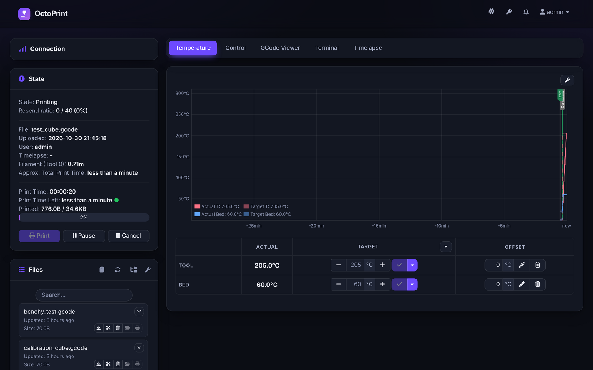 | 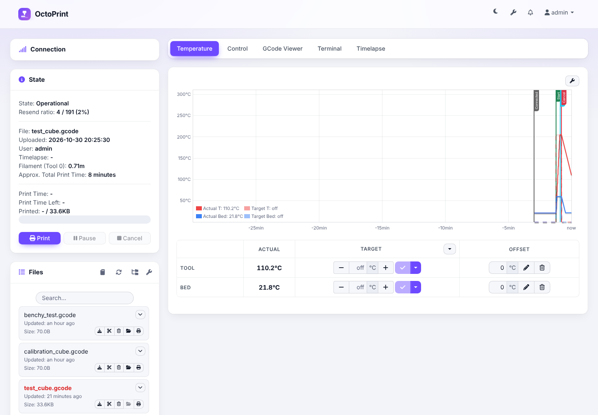 |
| **GCode viewer** | **Settings, with live preview** |
| 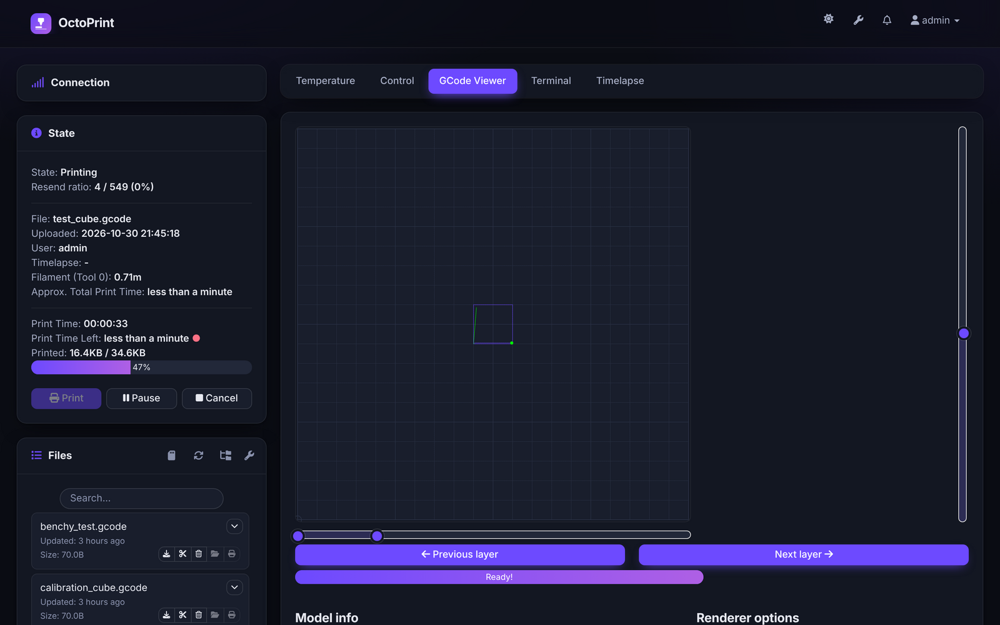 | 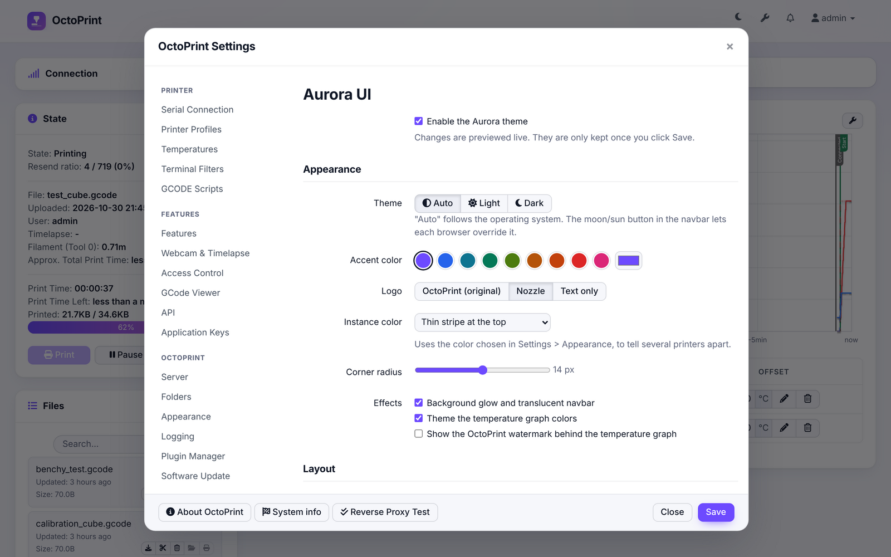 |

| **Print status card and floating webcam** | **Terminal: colors, favorites, recent commands** |
| --- | --- |
| 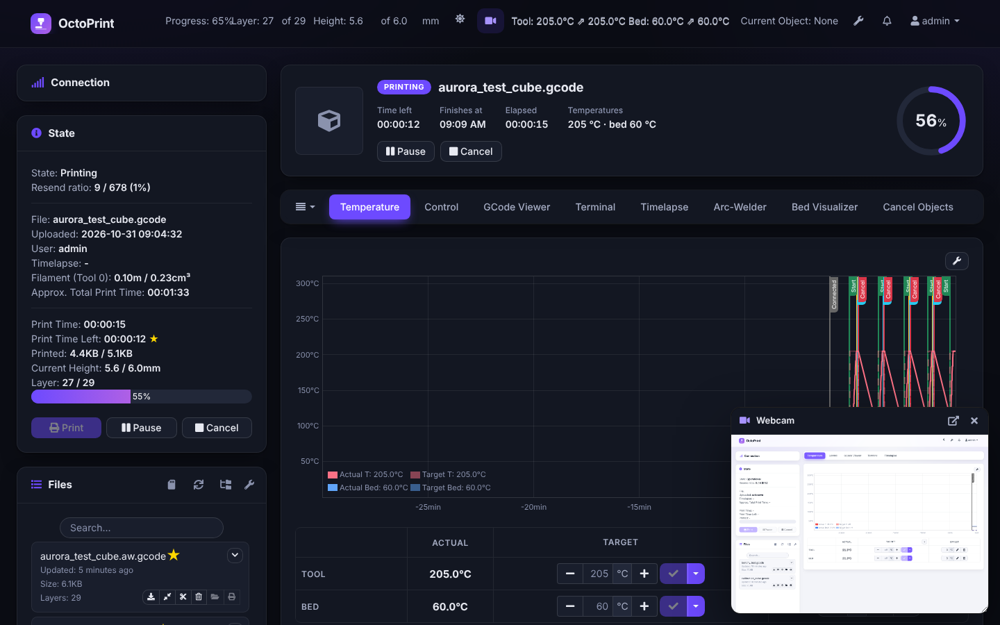 | 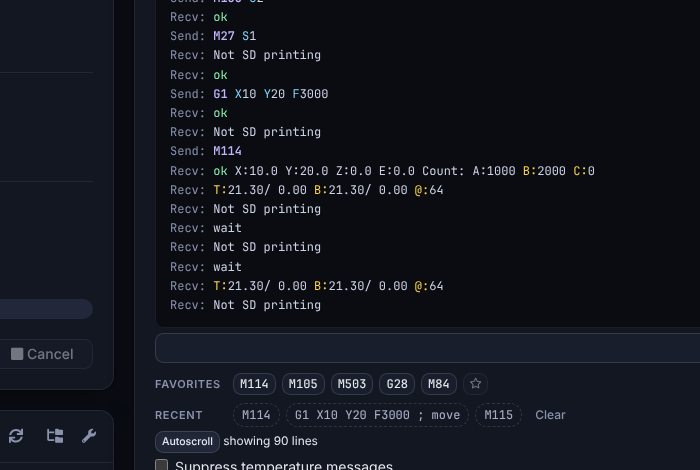 |
| **Panels and tabs** | **On a phone** |
| 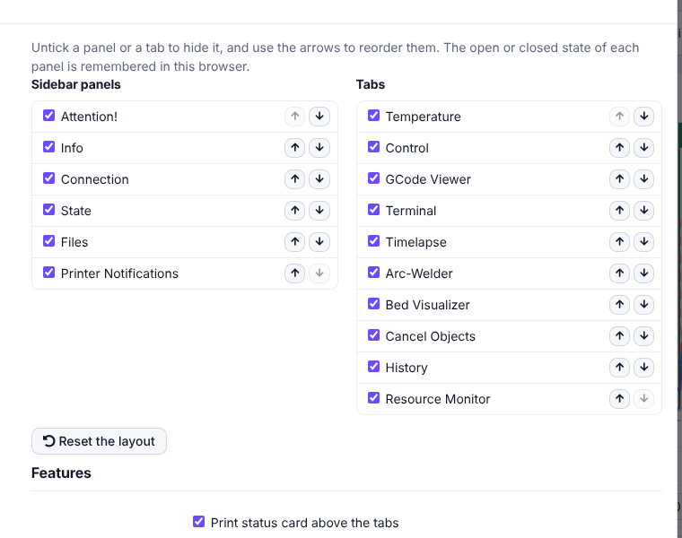 | 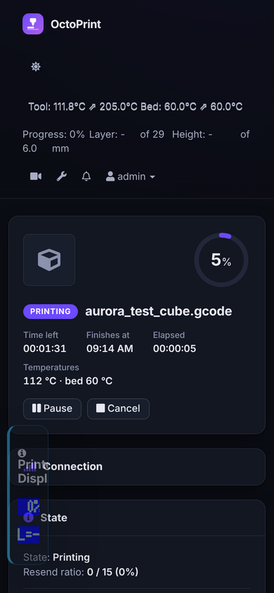 |
| **File grid with thumbnails** | |
| 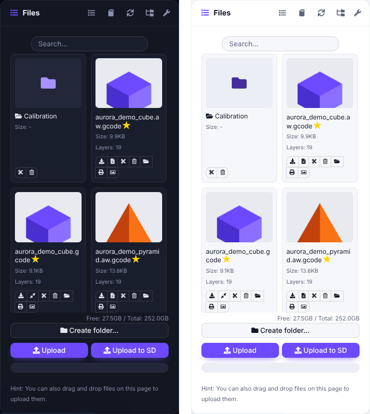 | |

<table>
  <tr>
    <th>Login page</th>
    <th>Phone</th>
    <th>Before (stock OctoPrint)</th>
  </tr>
  <tr>
    <td>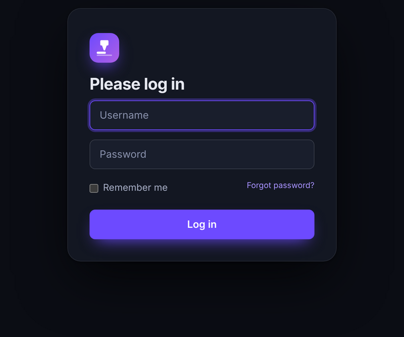<br>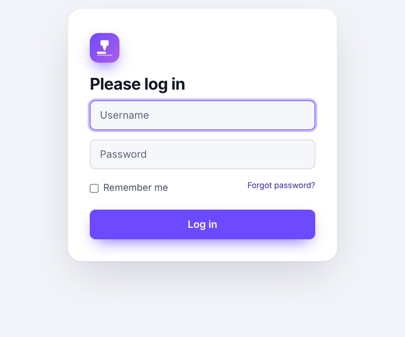</td>
    <td>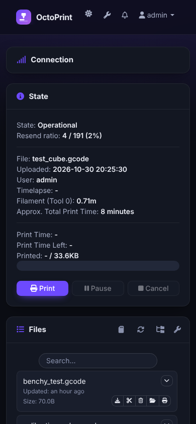</td>
    <td>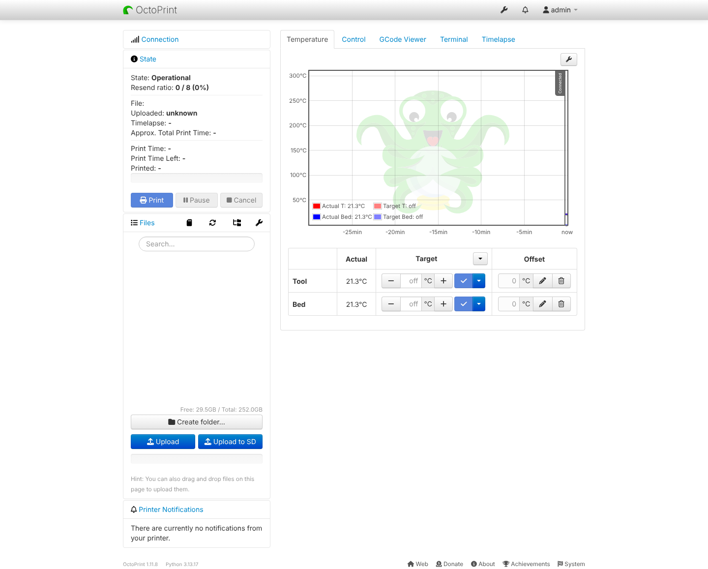</td>
  </tr>
</table>

## Installation

In OctoPrint, open **Settings › Plugin Manager › Get More…**, paste this URL into **… from URL** and click **Install**:

```
https://github.com/Limoniak/OctoPrint-Aurora/archive/refs/heads/main.zip
```

Restart OctoPrint when asked, then reload the page.

Or from the command line, in OctoPrint's Python environment:

```bash
pip install https://github.com/Limoniak/OctoPrint-Aurora/archive/refs/heads/main.zip
```

Once installed, new versions published on GitHub are offered by OctoPrint's own **Software Update**.

## Settings

Everything lives in **Settings › Aurora UI**.

| Setting | Options | Default |
| --- | --- | --- |
| Enable the Aurora theme | on / off | on |
| Theme | Auto, Light, Dark | Auto |
| Accent color | 9 presets or a custom color | violet `#6d4aff` |
| Logo | Nozzle, OctoPrint (original), Text only | Nozzle |
| Instance color | Thin stripe at the top, Use as accent color, Ignore | Thin stripe |
| Corner radius | 0 to 28 px | 14 px |
| Effects | Background glow and translucent navbar · Themed temperature graph · OctoPrint watermark behind the graph | first two on |
| Density | Comfortable, Compact | Comfortable |
| Sidebar position | Left, Right | Left |
| Full width on large screens | on / off | on |
| Panels and tabs | show, hide and reorder each one | all shown, OctoPrint's order |
| Print status card above the tabs | on / off | on |
| Print progress in the browser tab | on / off | on |
| Floating webcam button in the navbar | on / off | on |
| Terminal tools | on / off | on |
| Grid view with thumbnails for the file list | on / off (then list or grid per browser) | on, list shown until you switch |
| Favorite commands | any G-code, up to 20 | M114, M105, M503, G28, M84 |

The navbar's moon/sun button overrides the theme for the current browser only, so a tablet next to the printer can stay dark while your desktop follows the system.

## Compatibility

**OctoPrint.** Developed and tested on OctoPrint 1.11.8, including the setup wizard, every settings page, the About dialog, a full simulated print (heating, printing, pause, resume, cancel) and the GCode viewer.

**Browsers.** Full rendering on Chrome/Edge 111+, Firefox 113+ and Safari 16.2+. Older browsers, such as the one on a printer's touch screen, get the same theme with a few tinted backgrounds replaced by plain ones.

**Third-party plugins.** Tested together, on OctoPrint 1.11.8, with the ten most used plugins according to OctoPrint's official usage statistics (October 2026):

> Bed Level Visualizer · PrintTimeGenius · Firmware Updater · Dashboard · UI Customizer · Slicer Thumbnails · Cancelobject · DisplayLayerProgress · Themeify · Preheat Button

as well as Octolapse, OctoEverywhere and Obico, and with a real-world setup of fourteen plugins installed together on Python 3.11: Arc Welder, Bed Visualizer, BLTouch, Cancel Objects, Change Filament, Cura Thumbnails, DisplayLayerProgress, Navbar Temperature, Print History, PrintTimeGenius, Resource Monitor, Simple Filament Change Buttons, Slicer Thumbnails and Telegram. Their tabs, panels and settings pick up the theme, with no JavaScript errors and readable contrast in both themes. A few elements keep the colors their plugin forces on purpose: Obico's branded panel, Octolapse's preview box and warning label, Dashboard's webcam buttons and chart labels, and Change Filament's red warning. Print History's summary rows and Resource Monitor's mini graphs, which were hard-coded light, are adapted to the dark theme.

| Plugin | How Aurora handles it |
| --- | --- |
| **UI Customizer** | Fully supported. UI Customizer keeps its layout (columns, widgets, fixed header and footer, settings menu) and Aurora provides the colors. Aurora's own panel and tab options step aside, since UI Customizer manages the layout. |
| **Themeify** | Another complete theme: running both gives mixed results. Aurora shows a notice when both are active, so you can disable one. |
| **TouchUI** | Aurora steps aside in any browser where TouchUI is active, and comes back when it is turned off. |

## Languages

The plugin's own interface is available in English, French, Spanish, Portuguese (Portugal), Russian, German and Italian, and follows the language chosen in OctoPrint.

Want to add or fix a translation? See [Translations](#translations) below. Pull requests are welcome.

## Development

```
octoprint_aurora/
├── __init__.py                 settings, assets, templates, login stylesheet route, hooks
├── static/
│   ├── css/aurora.css          the theme: color tokens, then the components
│   ├── js/aurora.js            applies the theme, themes the graphs, settings view model
│   ├── js/aurora_progress.js   print status card and progress in the browser tab
│   ├── js/aurora_webcam.js     floating webcam
│   ├── js/aurora_terminal.js   terminal coloring, recent and favorite commands
│   ├── js/aurora_layout.js     hidden and reordered panels and tabs
│   ├── js/aurora_files.js      grid view of the file list
│   └── img/                    the Nozzle logo and OctoPrint's original logo
├── templates/                  settings page, navbar buttons, print card, floating webcam,
│                               terminal tools, file view toggle, login stylesheet
└── translations/               de, es, fr, it, pt, ru (.po and compiled .mo)
tests/
├── test_plugin.py              unit tests (pytest)
├── e2e/                        browser tests (Playwright)
└── run_e2e.sh                  starts a throwaway OctoPrint and runs the browser tests
```

For a development install:

```bash
pip install -e .
```

### How the theme works

- **Scoped.** Every rule starts with `html.aurora`, so disabling the theme removes it completely.
- **Tokens.** Colors are CSS custom properties (`--a-bg`, `--a-surface`, `--a-text`, …) defined once for the light theme and once for the dark theme at the top of `aurora.css`. The login page reads the same two blocks, so there is a single place to edit.
- **Applied by script.** `aurora.js` sets the `aurora` class, the `data-aurora-*` attributes and the accent-derived colors on `<html>`. It caches the last settings in `localStorage`, so the theme is there before the settings have even loaded.
- **Graphs.** The temperature graph (Flot) and the GCode viewer draw on a canvas; `aurora.js` passes them the theme colors.
- **Plugin-friendly.** Base rules (links, headings, code, labels) are wrapped in `:where()` so they never outweigh a plugin's own classes.

### Customizing colors

Edit the variables in the `html.aurora[data-aurora-theme="light"]` and `html.aurora[data-aurora-theme="dark"]` blocks at the top of `octoprint_aurora/static/css/aurora.css`. The login page picks them up automatically.

### Translations

Strings are extracted with Babel, which comes with OctoPrint. After changing a string in a template or in `aurora.js`:

```bash
pybabel extract -F babel.cfg -o translations/messages.pot --no-location --omit-header .
pybabel update -i translations/messages.pot -d octoprint_aurora/translations
```

Fill in the new entries of each `messages.po`, then compile:

```bash
pybabel compile -d octoprint_aurora/translations
```

Keep the `.po` files next to the `.mo` files: OctoPrint reads the `.po` files for the JavaScript strings. To add a language:

```bash
pybabel init -i translations/messages.pot -d octoprint_aurora/translations -l <code>
```

### Tests

Unit tests, in an environment where OctoPrint is installed:

```bash
pip install pytest
pytest tests
```

They also check that the copies of shared data stay in sync (instance colors, default settings, accent presets) and that every translation is complete.

Browser tests, against a real OctoPrint with the virtual printer:

```bash
pip install .
cd tests/e2e && npm install && npx playwright install chromium && cd ../..
tests/run_e2e.sh
```

They check the contrast of every page in both themes, run a simulated print, exercise the features (layout, remembered panels, file grid, terminal tools, floating webcam, print status card, tab progress) and go through the settings (live preview, revert, save, reload, disable). `TESTS="features.js" tests/run_e2e.sh` runs a single file. OctoPrint refuses to run as root, so run them as a regular user.

## License

[AGPL-3.0-or-later](LICENSE), like OctoPrint itself.

The "OctoPrint (original)" logo option uses OctoPrint's own tentacle image, which belongs to the OctoPrint project.
