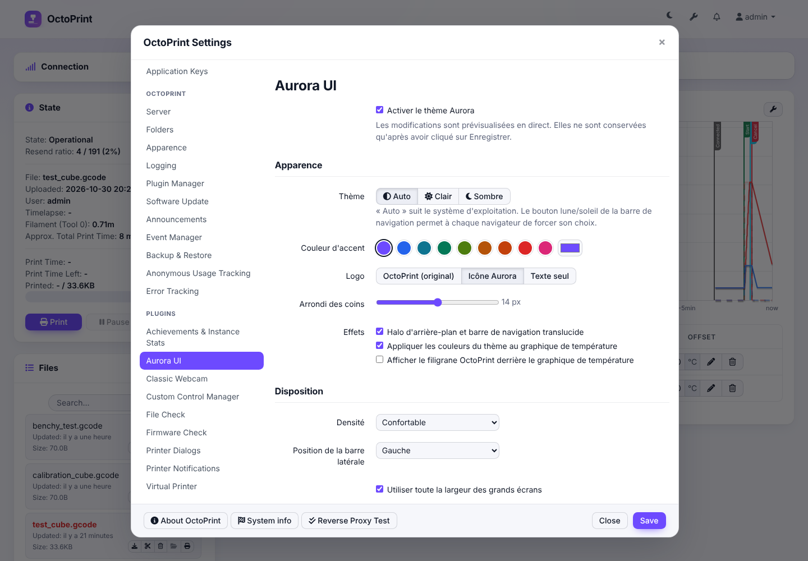
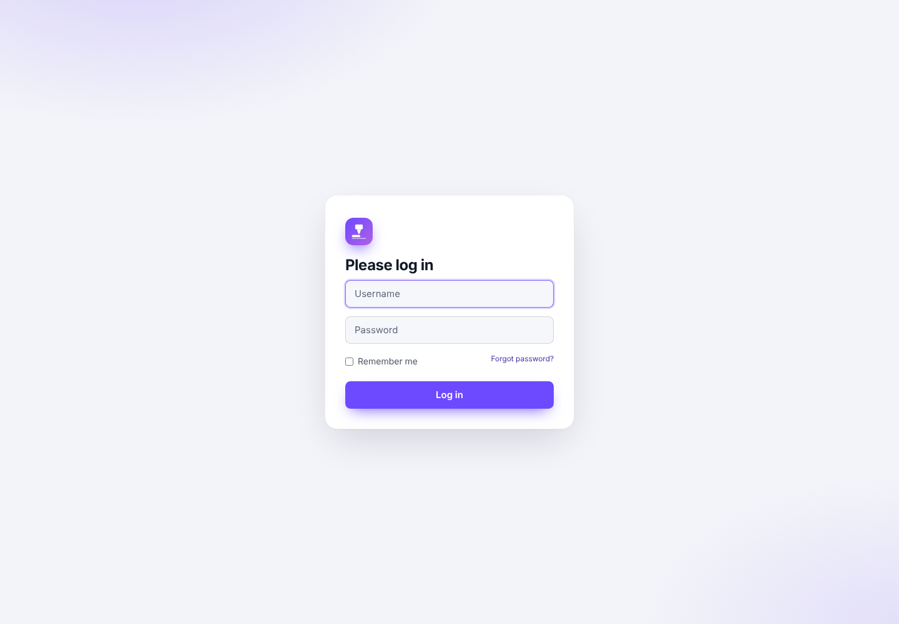

# OctoPrint-Aurora

Une refonte complète du design de l'interface web d'OctoPrint : cartes modernes, thème clair/sombre, couleur d'accent personnalisable et mise en page fluide. Toutes les fonctionnalités d'OctoPrint et des autres plugins restent intactes.

| Avant | Après (clair) | Après (sombre) |
| --- | --- | --- |
|  |  |  |

| Réglages | Connexion | Mobile |
| --- | --- | --- |
|  |  |  |

## Fonctionnalités

- **Nouveau design de toute l'interface** : barre de navigation translucide, panneaux en cartes, onglets en pilules, boutons, formulaires, tableaux, fenêtres modales, menus, notifications, terminal et liste de fichiers.
- **Thème clair, sombre ou automatique** (suit le système). Un bouton lune/soleil dans la barre de navigation permet à chaque navigateur de forcer son choix.
- **Couleur d'accent** : 9 préréglages ou n'importe quelle couleur. La couleur du texte sur l'accent (blanc ou noir) est calculée automatiquement pour rester lisible.
- **Graphique de température redessiné** : couleurs des courbes et de la grille adaptées au thème, filigrane OctoPrint masquable.
- **Mise en page** : barre latérale à gauche ou à droite, densité confortable ou compacte, pleine largeur sur grands écrans, rayon des coins réglable.
- **Logo « Buse »** : une buse qui dépose un cordon de filament, sur une tuile aux couleurs de l'accent, dans la barre du haut, sur la page de connexion et en icône d'onglet. Le logo original d'OctoPrint ou le texte seul restent disponibles dans les réglages.
- **Interface traduite** en français, espagnol, portugais, russe, allemand et italien (en plus de l'anglais) : la langue suit celle choisie dans OctoPrint.
- **Page de connexion** stylée elle aussi (via le hook `octoprint.theming.login`).
- **Aperçu en direct** dans les réglages : rien n'est conservé tant que vous n'avez pas cliqué sur *Save*, et un *Close* annule l'aperçu.
- **Couleur d'instance** : la couleur choisie dans *Settings → Appearance* (utile pour distinguer plusieurs imprimantes) s'affiche en fin liseré en haut de l'écran, ou peut servir de couleur d'accent.
- **Désactivable d'un clic** : toutes les règles sont limitées à `html.aurora`, donc décocher « Enable » restaure instantanément le design d'origine.

## Installation

Dans OctoPrint, ouvrez *Settings → Plugin Manager → Get More…* et collez cette adresse dans « … from URL » :

```
https://github.com/Limoniak/OctoPrint-Aurora/archive/refs/heads/main.zip
```

Ou en ligne de commande, dans l'environnement Python d'OctoPrint :

```bash
pip install https://github.com/Limoniak/OctoPrint-Aurora/archive/refs/heads/main.zip
```

Les mises à jour sont ensuite proposées automatiquement par OctoPrint (*Software Update*) à chaque nouvelle version publiée sur GitHub.

Pour le développement :

```bash
pip install -e .
```

Redémarrez ensuite OctoPrint. Testé avec OctoPrint 1.11.8 sous Python 3.13.

## Structure

```
octoprint_aurora/
├── __init__.py                     # plugin : réglages, assets, templates, route /login.css
├── static/
│   ├── css/aurora.css              # le thème (tokens --a-* + composants)
│   ├── js/aurora.js                # application du thème, graphique, view model
│   └── img/
│       ├── brand.svg               # logo « Buse » (aussi dessiné dans aurora.js pour l'icône d'onglet)
│       └── tentacle.png            # logo d'origine d'OctoPrint, version verte
└── templates/
    ├── aurora_settings.jinja2      # page de réglages du plugin
    ├── aurora_navbar.jinja2        # bouton clair/sombre
    └── aurora_login_css.jinja2     # feuille de style de la page de connexion
└── translations/<langue>/LC_MESSAGES/messages.{po,mo}   # fr, es, pt, ru, de, it
```

### Comment ça marche

- `aurora.js` pose sur `<html>` la classe `aurora` et les attributs `data-aurora-theme`, `data-aurora-density` et `data-aurora-sidebar`, ainsi que les variables `--a-accent`, `--a-on-accent` et `--a-radius`. La dernière configuration est mise en cache dans `localStorage` pour l'appliquer dès le chargement, sans afficher brièvement l'ancien thème.
- `aurora.css` définit les couleurs du thème (`--a-bg`, `--a-surface`, `--a-text`…) pour le clair et le sombre, puis stylise les composants Bootstrap 2 d'OctoPrint à partir de ces variables. La mise en page passe en CSS Grid.
- Le graphique de température est dessiné dans un canvas par Flot : `aurora.js` enveloppe `$.plot` (uniquement pour `#temperature-graph`) pour y injecter les couleurs du thème.

### Personnaliser

Pour modifier une couleur du thème, changez la variable correspondante dans les blocs `html.aurora[data-aurora-theme="light"]` / `"dark"` en haut de `aurora.css`. La page de connexion lit ces mêmes blocs au moment où elle est servie : il n'y a rien à reporter ailleurs.

## Traductions

Les textes sont extraits avec Babel (installé avec OctoPrint). Après avoir modifié un texte dans un template ou dans `aurora.js` :

```bash
pybabel extract -F babel.cfg -o translations/messages.pot --no-location --omit-header .
pybabel update -i translations/messages.pot -d octoprint_aurora/translations
```

Complétez les nouvelles entrées des fichiers `messages.po`, puis compilez :

```bash
pybabel compile -d octoprint_aurora/translations
```

Les fichiers `.po` doivent rester à côté des `.mo` : OctoPrint lit les `.po` pour les textes JavaScript.

Pour ajouter une langue : `pybabel init -i translations/messages.pot -d octoprint_aurora/translations -l <code>`.

## Compatibilité

- **Navigateurs** : rendu complet sur Chrome/Edge 111+, Firefox 113+ et Safari 16.2+. Les navigateurs plus anciens (par exemple celui d'un écran tactile branché sur l'imprimante) affichent le même thème, avec quelques fonds teintés remplacés par des fonds unis. Le flou de la barre de navigation est simplement ignoré quand il n'est pas pris en charge.
- **Accessibilité** : les textes respectent le contraste WCAG AA (4,5:1) dans les deux thèmes, y compris les liens et les boutons colorés. Les 9 couleurs d'accent proposées gardent un texte blanc lisible. Pour une couleur personnalisée, le texte des boutons passe en blanc ou en noir selon ce qui contraste le mieux.
- **Onglets d'OctoPrint** : Température (graphique aux couleurs du thème), Contrôle (webcam), GCode Viewer (fond, grille et lignes du modèle suivent le thème), Terminal, Timelapse, assistant de premier démarrage et toutes les pages des réglages.
- **Plugins tiers testés** : les 10 plugins les plus utilisés selon les statistiques officielles d'OctoPrint (instances actives, octobre 2026) : Bed Level Visualizer, PrintTimeGenius, Firmware Updater, Dashboard, UI Customizer, Slicer Thumbnails, Cancelobject, DisplayLayerProgress, Themeify et Preheat Button. Octolapse, OctoEverywhere et Obico ont aussi été testés. Tous ont été installés ensemble sur OctoPrint 1.11.8. Leurs onglets, panneaux et réglages prennent le thème, sans erreur JavaScript, avec un contraste conforme dans les deux thèmes. Les seules exceptions sont des choix de design des plugins eux-mêmes : le panneau à la marque d'Obico, l'encadré d'aperçu et l'étiquette « USE AT YOUR OWN RISK » d'Octolapse, les boutons de webcam et les graduations de graphique de Dashboard (couleurs forcées par le plugin). Les règles de base d'Aurora (liens, titres, code) ont une priorité volontairement faible, pour laisser les plugins styliser leurs propres éléments.
- **UI Customizer** : compatible. UI Customizer garde sa disposition (colonnes, widgets, barre du haut et pied de page fixes, menu des réglages) et Aurora fournit les couleurs. Note technique : UI Customizer désactive les règles CSS des plugins qui contiennent `#navbar .navbar-inner .nav`, c'est pourquoi Aurora écrit ces sélecteurs sous la forme `#navbar > .navbar-inner .nav`.
- **Themeify** : c'est un autre thème complet, et il s'active tout seul à son installation. Utiliser les deux en même temps donne un résultat incohérent. Aurora affiche alors une notification au chargement de la page (une fois par session) et un avertissement dans ses réglages : désactivez l'un des deux.

## Licence

AGPL-3.0-or-later, comme OctoPrint.
